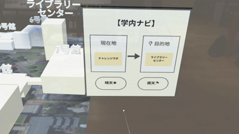
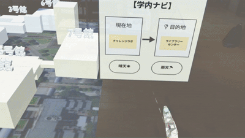

# SchoolNavigation - MR技術を用いた学内ナビゲーションシステム

HoloLens 2で、大学のキャンパスをジオラマとして表示し、建物の位置関係と建物間の経路を直感的に理解できるナビゲーションアプリです。
初めて大学を訪れる人でも、安心して目的の建物へ移動できることを目指しています。
2025年度の作品制作として、2人で開発しました。
私はUnityを担当し、スクリプトの記述やCGの配置を行いました(建物や建物名のCGは、もう1人のメンバーが担当)。

## デモ

### 晴天時の経路


### 雨天時の経路


※ 地面の航空写真:©Google

## 制作の背景

学内は建物が多く、初めて来る人は迷いやすいという課題があります。
スマートフォンの地図では、学内の建物同士の位置関係が分かりづらく、建物から建物への経路も把握しにくいです。
そこで、学内をジオラマとして目の前に表示し、経路を直感的に理解できて、実際の移動にも結びつくナビゲーションを考えました。

## 主な機能

- **ジオラマ表示**:Blender GISで作成した学内の地図を、ジオラマとして表示します
- **建物名の表示**:各建物の上に建物名を表示します。現在地は青、目的地は赤で強調します
- **経路の可視化**:建物から建物への経路を、立体的に表示します
- **天候に応じた経路の切り替え**:メニューの「晴天」「雨天」ボタンで、天候に合わせた経路を表示します。晴天時は屋外を含めた最短経路、雨天時は屋内のみを通る最短経路を表示します
- **ハンドトラッキング**:手でメニューのボタンを押して操作できます

## 工夫した点・苦労した点

### 1. 操作方法を音声認識からハンドトラッキングに変更した
テスト段階では、音声認識で建物名を指定する機能を実装しました。
検証の結果、音声入力の必要性が低いと判断し、ハンドトラッキングでの操作に切り替えました。

### 2. 経路を立体的に表示した
経路を視覚的に分かりやすくするため、平面ではなく立体的に表示しました。
これにより、階段を上がるような高低差のある経路でも、どこを通ればよいかが分かりやすくなるようにしました。

### 3. ジオラマ作成用のアドオンの選定
学内の簡易ジオラマを作成するため、アドオンを比較・検討し、Blender GISを選定しました。

## 今後の課題

基本機能は実装済みですが、次の点は未実装で、今後追加したい機能と考えています。

- 現在地から目的地までの所要時間と距離の表示(メニュー)
- ジオラマ内での天気の再現(雨や雪が降るなどの演出)
- 建物を選択したときの詳細情報の表示
- AIを活用した最適な経路の表示(現在は、あらかじめ決めたルートを表示しています)

## 使用技術

- Unity 2022.3.10f1
- HoloLens 2
- Mixed Reality Toolkit (MRTK) 2.8.3
- Mixed Reality OpenXR Plugin 1.11.2
- OpenXR Plugin 1.8.2
- Blender / Blender GIS
- C#

## フォルダ構成

```
docs/                            READMEのデモGIF
Assets/
├── Scenes/
│   ├── SchoolNavigation.unity   メインのシーン
│   └── SchoolNaviTest.unity     テスト段階のシーン
├── Scriput/                     スクリプト
│   ├── CommonArea.cs
│   ├── DisplayBuildiing.cs
│   ├── HandTracking.cs
│   └── VoiceInput.cs            テスト段階の音声入力
├── Object/                      ジオラマ、建物名、経路の矢印などのモデル
│   └── Menu/                    メニュー画像
└── Material/                    マテリアル
```

## 使用アセット・クレジット

- Mixed Reality Toolkit 2.8.3(Microsoft、MITライセンス)
- 建物・建物名のCG:共同制作者が制作
- メニュー画像は、PowerPointで自作しました。
- 建物・道路の形状:© OpenStreetMap contributors
- 地面の航空写真:Google(利用条件により、このリポジトリには含めていません)

## 注意事項

MRTKなどのライブラリは、このリポジトリに含めていません。
そのため、Unityでプロジェクトを開くと、パッケージの読み込みエラーが出ることがあります。
また、地面の航空写真を含めていないため、ジオラマの地面にはテクスチャが表示されません。
